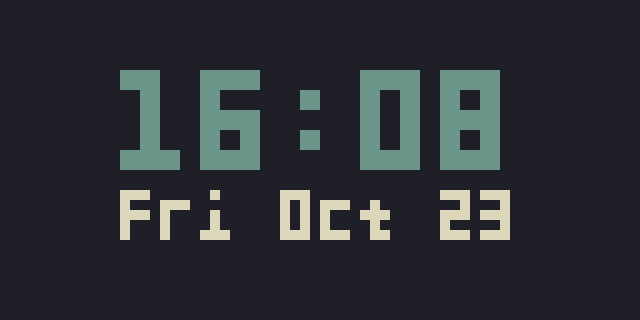

# Pixeldash

A small dashboard for a 64 x 32 RGB LED matrix. It cycles between a clock,
weather, and Spotify playback, with a desktop emulator for trying it without
the hardware.



## Try it

You'll need Python 3.10 or later. From the project directory:

```sh
python3 -m venv .venv
. .venv/bin/activate
python -m pip install .
pixeldash
```

The emulator starts with the clock and Hello World screens. Use the left and
right arrow keys to switch screens, or Space to advance. Press Q or Escape,
close the window, or press Ctrl-C in the terminal to quit.

To keep just the clock on screen:

```sh
pixeldash --screens clock
```

You can also launch it with `python -m pixeldash`. Run `pixeldash --help` for
the available options.

## Settings

Put your settings in `config.local.yaml`. You only need to include the values
you want to change. For example:

```yaml
emulator:
  pixel_size: 8
dashboard:
  screens: [clock, hello]
  interval: 10
clock:
  show_date: true
  format_24h: false
```

`pixel_size` controls the emulator window size; it does not change the matrix
resolution. The available screens are `clock`, `hello`, `weather`,
`weather-clock`, and `spotify`. `weather-clock` combines the time, date, and
temperature on one screen.

Pixeldash reads `config.yaml` and then `config.local.yaml` from the directory
where you run it. Both files are optional. To use a file elsewhere, pass
`--config /path/to/config.yaml`; this loads that file over the built-in
defaults. `--screens` and `--interval` override the corresponding settings.
Local settings and the default Spotify token cache are ignored by Git.

## GIF preview

To preview your own animation in the emulator, run this from the project directory:

```sh
python examples/gif_preview.py /path/to/animation.gif
```

## Weather and Spotify

Install the optional service dependencies:

```sh
python -m pip install '.[services]'
```

For weather, get an [OpenWeather API key](https://openweathermap.org/appid)
and add your city and key to `config.local.yaml`:

```yaml
weather:
  city: "Boston,MA,US"
  units: imperial
  api_key: "your-api-key"
```

Use `metric` for Celsius or `imperial` for Fahrenheit. Weather refreshes every
ten minutes. Run it with:

```sh
pixeldash --screens clock weather
```

For Spotify, create an app in the
[Spotify developer dashboard](https://developer.spotify.com/dashboard).
Register `http://127.0.0.1:8888/callback` as its
[redirect URI](https://developer.spotify.com/documentation/web-api/concepts/redirect_uri),
then add your app's credentials to `config.local.yaml`:

```yaml
spotify:
  client_id: "your-client-id"
  client_secret: "your-client-secret"
```

```sh
pixeldash --screens clock spotify
```

The first Spotify request opens a browser for sign-in. Playback refreshes
every five seconds. You can change `spotify.redirect_uri` and
`spotify.cache_path` in the config if needed. The service screens also accept
`OPENWEATHER_API_KEY`, `SPOTIFY_CLIENT_ID`, and `SPOTIFY_CLIENT_SECRET` from
environment variables or a `.env` file. Environment variables take precedence
over YAML credentials.

## LED matrix

On a Raspberry Pi, install and build the Python bindings from
[rpi-rgb-led-matrix](https://github.com/hzeller/rpi-rgb-led-matrix/tree/master/bindings/python).
Set the panel's rows, columns, chain length, parallel count, and hardware
mapping under `matrix` in your config. Set `display.width` to
`matrix.cols * matrix.chain_length` and `display.height` to
`matrix.rows * matrix.parallel`.

```sh
pixeldash --display matrix --screens clock
```

The matrix driver may require elevated privileges; follow its setup
instructions for your board. The desktop emulator does not use the matrix
driver.
